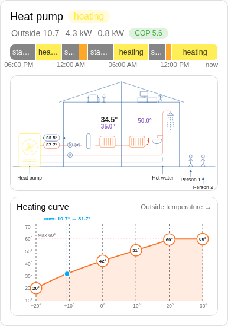

# open3e Gateway (ESP32) for Home Assistant

A custom integration for Viessmann E3 heat pumps (tested with a Vitocal 150-A)
through an [open3e-esp32](https://github.com/boonkerz/open3e-esp32) gateway. It
uses the gateway's local HTTP API. MQTT is not needed.

## Features

- Setup in the UI with the gateway's IP address.
- One entity for each field of every datapoint selected on the gateway: sensors
  (with units and device classes), enum text sensors and binary sensors. Min,
  max, average and status fields are created disabled.
- **Controls only where the gateway has a write limit.** A field becomes a
  `number` only if its datapoint has a `range` in the gateway's selection. The
  gateway enforces that limit on every write. Datapoints that the open3e DB
  marks read-only (e.g. 880 heating curve) are written with `force`. The limit
  still applies.
- Hot water one-time charge as a switch. Its state is the request (DID 1006).
  The heat pump's own state (1007) is in the `active` attribute and has its
  own binary sensor.
- Running sensors for the compressor (2351) and electric heater (2352).
- **Heating circuit flow** as a read-only `climate`: current = circuit flow
  (284), flow setpoint (987) as attribute. The setpoint is not set directly:
  change the heating curve level (number entity of 880) instead; one step
  moves the flow setpoint by 1 K (measured on a Vitocal 150-A).
- **Hot water** as a `water_heater` (temperature, setpoint 396, operation mode
  heat_pump / high_demand = one-time charge).
- Derived sensors: operating state (off / standby / heating / hot water /
  electric heater), current COP (thermal / electrical power while the
  compressor runs) and flow/return spread.
- German and English names; ECU devices are named "Wärmepumpe", "Kältekreis".
- Read-back after every write (the gateway does not republish).
- Gateway diagnostics: WLAN signal, CAN state and errors, poll failures.

## Heat pump card

The integration brings its own dashboard card; no extra resource is needed.
Add it via *Add card* (search for "open3e"); all options can be set in the
visual editor. In YAML:

```yaml
type: custom:open3e-heatpump-card
normal_level_entity: input_number.wp_niveau_normal   # optional
```



Header: operating state, outside temperature, heat and electrical power,
COP now and today's average (from the heat pump's energy counters; the colour
follows today's value), active errors.

Below the header a timeline shows the operating state over the last 24 h
(standby and off grey, heating yellow, hot water orange, electric heater red;
hover for the times, tap for the history). It reads the recorder history, so it
needs the `recorder` (on by default) and fills up from the time the integration
was installed.

The system diagram is a line-art cross-section of the house. The air-source
heat pump stands outside on the left; its fan spins while the compressor runs,
and its outline is yellow while heating and orange while making hot water.
Its own flow/return temperatures (268/269) sit on the pipes next to the unit,
at the height of the active loop. Inside: circulation pumps, a 3-way valve on
the active loop, a hydraulic separator (default), a buffer tank
(`storage: buffer`) or nothing (`storage: none`), two radiators, and the hot
water line rising to the bathroom (tap over the sink, shower). Pipes are thin
with rounded corners; small dots travel along the active loop (flow red,
return blue), idle pipes stay coloured but faint. Outlines are never greyed
out. Next to the radiators and the bathroom: actual temperature, and the
target in purple; while no hot water is being made only the hot water target
is shown. The buffer shows a temperature only if a sensor is available
(DID 279, or `entities: {buffer: sensor.x}`). Tap a value for its history.
With *reduce motion* switched on in the OS/browser nothing moves.

Two people stand in the yard, each with an arrow and a name (default
"Person 1" / "Person 2"). Set `person1_name` / `person2_name`, and optionally
`person1_entity` / `person2_entity` (a `person.*` entity: the figure turns green
while home, grey while away, tap for details); `show_people: false` hides them.

The heating curve chart shows the flow target over the outside temperature
(+20 … −30 °C, like the ViCare app) and the current point. The formula
`room target + level − slope · d · (1.4347 + 0.021·d + 0.0002479·d²)`,
d = outside − room target, reproduces the ViCare app's curve and the
controller's own flow target (987). It is limited to the circuit's min/max
flow when DID 1192 (MixerOneCircuitFlowTemperatureMinimumMaximumLimit) is in
the gateway selection (add it without a range: read-only). With
`curve_controls: true` a row below the chart shows the slope and the level;
− / + change the level (and the slope, if it is writable) as a draft, *Save*
writes it.

Optional tiles below the card (tap for details / to change a setpoint):

| Tile | Shows | Colour |
|---|---|---|
| Compressor | on/off + speed | green = running |
| HK Vorlauf Ist/Soll (optional) | circuit flow / flow setpoint, deviation in K | green within ±2 K, blue below, orange above |
| WP Vorlauf (optional) | heat pump flow | orange = heating, blue = hot water, grey = idle |
| Niveau · Neigung | heating curve level and slope (tap to change the level) | amber when it differs from `normal_level_entity` |
| Warmwasser Ist/Soll | tank / setpoint (tap to change the setpoint) | blue = charging, red = below the switch-on point, green = ok |
| Einmalladung | one-time charge | blue = on |

Options: `title`, `timeline` (default `true`), `hours_to_show` (default 24),
`temp_bar` (system diagram, default `true`), `storage` (`separator` | `buffer` | `none`),
`show_people` (default `true`), `person1_name`, `person1_entity`, `person2_name`, `person2_entity`, `curve` (heating curve, default `true`),
`curve_controls` (slope / level row below the curve, default `false`), `tiles` (list and order; default none;
available: level, one_time, compressor, dhw, flow_hk, flow_wp, return, flow_target,
circuit (heating circuit mode), dhw_set, heater), `entities` (override any entity, e.g. `flow_hk: sensor.x`),
`entry_id`.

## Bus load

Gateway firmware with `GET /api/values` returns the poller's cached values, so
a refresh causes no CAN traffic (default every 30 s). With older firmware the
integration reads each datapoint live, but not more often than its gateway
interval and not more often than the "minimum interval" option (default 120 s).
The `can_state` diagnostic sensor shows which mode is active.

## Installation (HACS)

HACS → Custom repositories → add this repository as type *Integration* →
install → restart HA → Settings → Devices & services → Add → "open3e Gateway".

Requires Home Assistant 2026.11 or newer.

## Choosing datapoints

The gateway's selection decides which entities exist. Add or remove
datapoints, or set write limits, in the gateway's web UI (Datenpunkte). The
integration checks the selection every 5 minutes and reloads itself when it
changes. Entities of removed datapoints are deleted. To apply a change at once,
reload the integration. Changing only the polling interval or the topic does
not trigger a reload.

## Security

The gateway's HTTP API has no authentication. Use it on a trusted LAN only.

## License

MIT, see [LICENSE](LICENSE).
